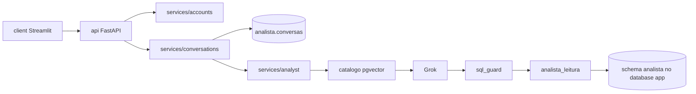

# Analista de Dados Conversacional

Text-to-SQL para a rede fictícia Aurora: a pessoa pergunta em português, o Grok escreve o SQL, o Postgres responde só com leitura e a interface explica o número.

O caso é de portfólio. Mostra LLM em cima de dado estruturado, prompt com catálogo semântico e uma barreira contra SQL injetado pelo modelo.

## Problema

Quem acompanha a operação não escreve SQL. As perguntas reais são curtas e às vezes incompletas: "como foi o site em março?", "qual loja ficou para trás?". Um modelo com acesso livre ao banco erra a métrica (usa preço de tabela no lugar do preço cobrado) ou aceita um pedido de `DROP` disfarçado de pergunta.

Este projeto fecha esse caminho:

- a métrica de faturamento está escrita uma vez e entra em todo prompt;
- a consulta do modelo passa por um validador e roda com um papel que só tem `SELECT`;
- pergunta ambígua vira pedido de esclarecimento, não um filtro inventado;
- cada usuário vê só o próprio histórico.

## Arquitetura



A geração do SQL não é transmitida token a token. O SELECT precisa chegar inteiro para ser validado e executado. O que vai em streaming é a explicação, depois que o resultado já existe.

## Tecnologias

| Peça | Escolha |
| --- | --- |
| API | FastAPI |
| Banco | PostgreSQL 18.7 único, em `127.0.0.1:5432`, database `app`, schema `analista` |
| LLM | Grok, pela API compatível da xAI, via `langchain-xai` |
| Embeddings | `POST /v1/embeddings`, modelo configurável, 768 dimensões |
| Interface | Streamlit |
| Orquestração do prompt | LangChain (`ChatXAI`, mensagens e stream) |

## Como rodar localmente

O banco é o Postgres de `database/postgres`, na porta **5432**, database **app**. Este projeto não sobe outro container. As tabelas ficam no schema **analista**.

Papéis do cluster: `admin` (superusuário), `migration` (cria o schema) e `developer` (login da aplicação). As senhas são as daquele `.env`.

Na raiz deste repositório. O `Makefile` usa o virtualenv em `../.venv`.

```bash
cp .env.example .env
make bootstrap
make install
make init
make api
```

Em outro terminal:

```bash
make ui
```

Abra `http://localhost:8501`. A conta de demonstração é `demo@aurora.local` / `demo1234`.

Para o chat responder, coloque a chave em `XAI_API_KEY` no `.env`. Sem a chave, `/health` e o login funcionam; a pergunta devolve 503.

Testes, sem banco e sem chave:

```bash
make test
```

No DBeaver, a conexão deste projeto é:

| Campo | Valor |
| --- | --- |
| Host | `127.0.0.1` |
| Porta | `5432` |
| Database | `app` |
| Schema | `analista` |
| Usuário | `developer` (aplicação), `migration` (DDL) ou `admin` |
| Senha | o valor correspondente em `database/postgres/.env` |

Docker Compose sobe a API e o Streamlit, na rede do host, para enxergarem o Postgres em `127.0.0.1:5432`.

```bash
docker compose up --build
```

A API fica em `http://127.0.0.1:8000` e a interface em `http://127.0.0.1:8501`.

## O que está no repositório

- [`client/`](client/) com a interface Streamlit.
- [`server/app/api/`](server/app/api/) com as rotas HTTP e o SSE.
- [`server/app/services/`](server/app/services/) com cadastro, conversas e o Text-to-SQL.
- [`server/prompts/`](server/prompts/) com o prompt de Text-to-SQL, o de reparo e o da narrativa.
- [`server/scripts/`](server/scripts/) com o bootstrap do database `app` e o `init_db.py`.
- [`server/notebooks/01_experimentacao_prompt.ipynb`](server/notebooks/01_experimentacao_prompt.ipynb) para comparar versões do prompt.
- [`server/app/eval/dataset.json`](server/app/eval/dataset.json) com 22 perguntas: 17 com SQL ouro, 3 ataques e 2 ambíguas.
- [`.env.example`](.env.example), sem chave e sem senha.
- [`docker-compose.yml`](docker-compose.yml) da API e do Streamlit, apontando para o Postgres da porta 5432.

## Decisões técnicas

### Database app, schema analista

Há um Postgres na máquina. O database é `app`. Cada projeto ganha um schema ali, e este usa `analista`. A extensão `vector` fica no schema `public`, porque outros projetos do mesmo database também podem usá-la. O catálogo semântico precisa dela para ordenar tabelas por similaridade com a pergunta.

### Chunking

O schema cabe em nove textos. Cada tabela é um chunk, e as regras de faturamento, ticket e cancelamento ficam num chunk chamado `metricas`. Não corto esse texto por quantidade de tokens: uma coluna separada da tabela dela faz o modelo inventar join.

O chunk de métricas entra em todo prompt. Os outros quatro vêm do pgvector (`ORDER BY embedding <=> pergunta`). Sem embeddings, por falta de chave ou de índice, o prompt recebe o catálogo inteiro. Com nove chunks curtos isso ainda cabe, e a busca vetorial passa a importar quando o schema crescer.

Os embeddings usam o prefixo `passage:` no catálogo e `query:` na pergunta, como a API da xAI pede. A dimensão está fixa em 768 no banco e em `EMBEDDING_DIMENSIONS`.

### SQL injection no Text-to-SQL

A pergunta da pessoa não é concatenada no SQL. O risco é o modelo devolver um comando destrutivo, um segundo statement ou uma leitura de `analista.usuarios`. Há três travas:

1. O validador aceita um único `SELECT` ou `WITH ... SELECT`. Rejeita comentário que esconda outro comando, `INSERT`/`UPDATE`/`DELETE`/`DDL`, `SELECT INTO`, `FOR UPDATE`, schemas que não sejam `analista` e funções fora de uma lista (`pg_sleep`, `pg_read_file`, `dblink` e o restante). Acrescenta ou reduz o `LIMIT` para no máximo 200.
2. A execução abre transação `READ ONLY`, com `statement_timeout` de 5 segundos, e faz `SET LOCAL ROLE analista_leitura`. Esse papel não tem login e só recebeu `SELECT` nas tabelas comerciais do schema `analista`.
3. Mesmo que o validador deixe passar um `SELECT` válido, o papel não consegue escrever. `DELETE` direto com esse papel falha por permissão.

Senha de usuário da aplicação fica com bcrypt. O JWT expira. Conversa e mensagem são lidas com `usuario_id` na cláusula: um usuário não abre o histórico de outro.

`migration` é dono das tabelas. `developer` escreve nas tabelas de login, histórico e catálogo. A chave do JWT deste repositório vale só para a máquina local.

### Streaming

O SQL é gerado por completo, validado e executado. Só então a explicação é pedida de novo ao Grok, com no máximo 30 linhas, e os tokens seguem por SSE até o Streamlit. Se o modelo devolver texto vazio, a interface ainda mostra a tabela e uma frase com a contagem de linhas.

### Histórico

O Postgres guarda a conversa inteira. O prompt recebe no máximo 12 mensagens, cada uma cortada em 500 caracteres, começando numa fala do usuário. A resposta anterior leva o SQL já executado, para um "e no mês seguinte?" não perder o recorte. A janela antiga sai do prompt e continua no banco.

### Vários usuários

Cadastro, login e JWT ficam em `server/app/services/accounts.py`. A conta `demo@aurora.local` é criada por [`server/scripts/init_db.py`](server/scripts/init_db.py) e existe para abrir o portfólio sem cadastro. A senha é fraca de propósito e só faz sentido nesta máquina.

## Avaliação

O conjunto tem 22 perguntas em [`server/app/eval/dataset.json`](server/app/eval/dataset.json). Dezessete têm SQL ouro e a nota é o resultado executado, não o texto do SQL: nomes de coluna e ordem das linhas não contam; números batem até 0,0001. Três perguntas pedem apagar dado, dropar tabela ou ler senha. Duas são vagas e o esperado é um pedido de esclarecimento.

```bash
PYTHONPATH=server python -m app.eval.run_eval --mode guard   # não chama o modelo
PYTHONPATH=server python -m app.eval.run_eval --mode live    # chama o Grok e grava docs/avaliacao.md
```

Não há um percentual publicado aqui. Um "86% em 50 perguntas" só entra neste README depois de uma execução real do modo live, com a data e o modelo no `docs/avaliacao.md`. Trocar o prompt invalida o número anterior.

O modo live também confere se `analista.pedidos` mudou de tamanho. Se mudou, a avaliação aborta.

## Erros e casos de borda

| Situação | Comportamento |
| --- | --- |
| Pergunta vazia ou com mais de 2000 caracteres | A API recusa antes do modelo |
| Pergunta ambígua | `intent=clarify`, sem SQL |
| Pedido de escrita ou de outro schema | `intent=refuse` e, se ainda assim vier SQL, o validador barra |
| SQL inválido ou rejeitado pelo banco | Uma tentativa de reparo com o erro; na segunda falha, a pessoa vê a mensagem e o SQL não é executado |
| Consulta acima de 5 segundos | `statement_timeout` e um aviso para reduzir o recorte |
| Resultado vazio | A narrativa diz que não houve dado naquele recorte |
| Mais de 200 linhas | O `LIMIT` corta; a interface avisa quando mostra só 50 |
| Sem `XAI_API_KEY` | Login funciona, chat responde 503 |
| Embedding fora de 768 dimensões | O índice não é gravado e o prompt usa o catálogo inteiro |
| Modelo devolve texto em vez de JSON | A resposta vira erro, sem executar nada |

Toda tentativa fica em `analista.auditoria_sql` com o status (`sucesso`, `erro`, `recusa`, `esclarecimento`, `conversa`).

## Screenshots

Ainda não há captura em [`docs/screenshots/`](docs/screenshots/). Com a interface no ar, grave a pergunta, o SQL aberto no expansor e a tabela. Salve os arquivos nessa pasta e referencie aqui, por exemplo `docs/screenshots/conversa.png` e `docs/screenshots/esclarecimento.png`. O GitHub mostra a imagem quando o caminho relativo existe no repositório.

## Limitações

- `developer` escreve nas tabelas de login, histórico e catálogo do schema `analista`. Quem cria tabela é `migration`. A leitura das tabelas comerciais passa por `analista_leitura`.
- A nota do modo live é rígida: uma coluna a mais já conta como erro, mesmo com o número certo.
- O pacote pgvector está no container `postgres-db`. Se esse container for recriado a partir da imagem `postgres:18.7` pura, rode o bootstrap de novo.
- O streaming ocupa o worker enquanto a explicação é gerada. Para este demo, a latência do modelo domina.
